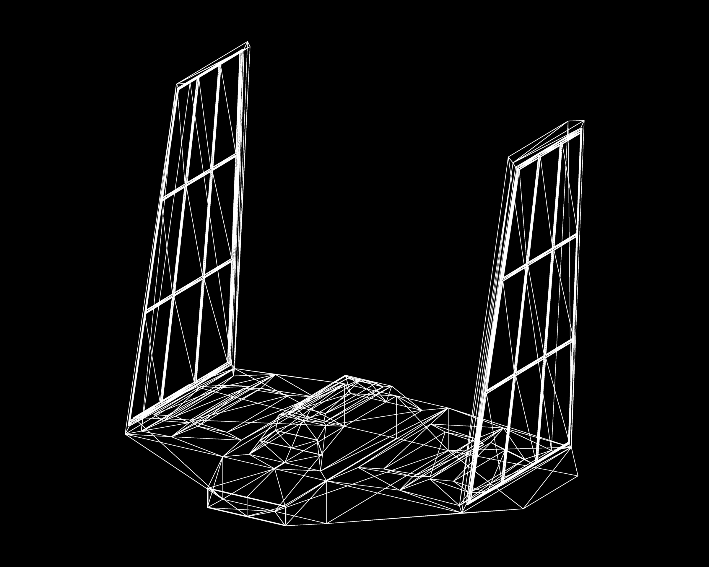

**Universidad del Valle de Guatemala** 
**Facultad de Ingeniería** 
Gráficas por Computadora

# Proyecto 1 — Parte 1

Dibujando un modelo OBJ

**Juan Francisco Orozco Mijangos** 
Carné: 24647

---

## Descripción del proyecto

En esta primera parte de nuestro renderer utilizamos el cargador OBJ del laboratorio anterior para dibujar todos los triángulos de una nave que modelamos en Blender. Seguimos el recorrido de las clases: leemos vértices, guardamos los índices de las caras y conectamos sus posiciones con nuestras funciones `triangle`, `line` y `point`.

En el lector identificamos las líneas `v` y `f`. Guardamos las posiciones en un `Vec<Vector3>` y los índices en un `Vec<usize>`, dentro de la estructura `Obj`. Para una referencia como `12/4/8`, usamos únicamente el primer número y le restamos uno, porque los índices de OBJ comienzan en uno y los de Rust comienzan en cero. Ignoramos materiales, normales y coordenadas de textura. El archivo debe estar triangulado.

Recorremos los índices en grupos de tres con `chunks_exact(3)` y buscamos las tres posiciones correspondientes para cada cara. Nuestra función `triangle` recibe esas posiciones como `Vector2` y llama a `line` para conectar A–B, B–C y C–A. Usamos Bresenham para recorrer los píxeles de cada línea y `point` para escribirlos. Raylib nos proporciona los vectores, la imagen y la ventana; no usamos un cargador OBJ externo ni funciones automáticas para dibujar líneas, triángulos o modelos 3D. La textura que presentamos en la ventana contiene exclusivamente los píxeles calculados por nuestras funciones.

Mostramos únicamente la nave con contornos blancos y fondo negro. Para obtener el ángulo frontal ligeramente de lado de nuestra referencia, giramos las posiciones 32° horizontalmente e inclinamos la vista 22° antes de convertirlas a 2D. Aplicamos una escala uniforme y centramos el resultado. No aplicamos perspectiva, relleno, iluminación ni eliminación de caras ocultas.

Para suavizar las diagonales dibujamos a doble resolución y reducimos la imagen a **2400 × 1920 píxeles**. El giro y el suavizado son ajustes de presentación solicitados para esta vista; el lector y la conexión de triángulos siguen la estructura de clase.

## Resultado

